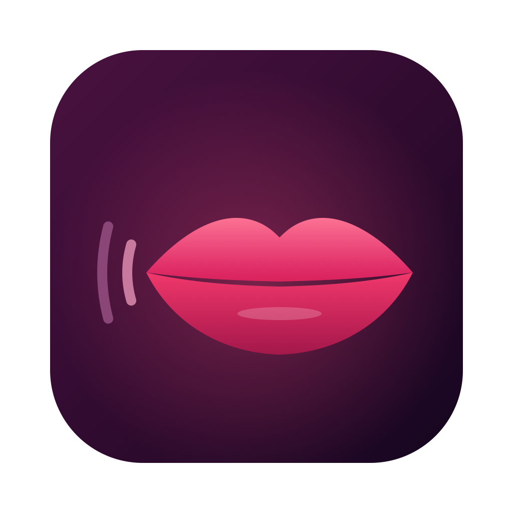

# Tézeu

Petite app de dictée pour Mac, 100 % locale. Tu maintiens une touche, tu parles,
tu relâches : le texte s'écrit dans l'app ouverte. Ta voix et ton texte restent sur ton Mac.

Le nom vient de « taiseux » : quelqu'un qui parle peu et garde tout pour lui.

App originale. Aucun code, nom, logo ou texte d'une autre app de dictée n'a été repris.

> **English** — Tézeu is a 100% offline push-to-talk dictation app for macOS (Apple Silicon).
> Hold a key, speak, release: the text is pasted into the active app. Speech recognition runs
> locally with [whisper.cpp](https://github.com/ggml-org/whisper.cpp) on Metal. No account,
> no telemetry, no network access except the explicit, checksum-verified model download.
> Dictation in French, English, Spanish, German, Italian, Portuguese and Dutch (or auto-detect).
> English and French interface. Swift / SwiftUI menu bar app, builds without Xcode. MIT licensed.

État : version 0.1, en développement.

## Installer avec Homebrew

```
brew tap sinepel/tezeu https://github.com/Sinepel/Tezeu
brew install --cask tezeu
```

La formule (`Casks/tezeu.rb`) est dans ce dépôt. Elle n'est pas dans le catalogue officiel de Homebrew :
celui-ci refuse les apps non notarisées par Apple. Elle pointe vers la dernière version stable,
et la GitHub Action la met à jour à chaque release stable. Mêmes limites que ci-dessous :
au premier lancement, « Ouvrir quand même ».

## Installer une version compilée

Chaque release publiée sur GitHub contient `Tezeu-vX.Y.Z-macos-arm64.zip`, compilée par une
GitHub Action (`.github/workflows/release.yml`), avec son empreinte SHA-256.

1. Télécharge le zip depuis la page **Releases**, ouvre-le, glisse `Tezeu.app` dans **Applications**.
2. Au premier lancement, macOS bloque l'app : elle n'est pas validée par Apple (pas de compte
   Apple Developer). Va dans Réglages Système > Confidentialité et sécurité, et clique sur
   **Ouvrir quand même**. Ou, dans Terminal : `xattr -dr com.apple.quarantine /Applications/Tezeu.app`
3. Donne les autorisations Micro et Accessibilité.

Depuis la 0.2.0, la version compilée est signée avec le certificat « Tezeu Dev » (voir plus bas).
La signature reste la même d'une version à l'autre : l'autorisation Accessibilité est gardée
après une mise à jour.

Tu viens d'une version plus ancienne (signature « ad hoc ») ? Une seule fois : dans Réglages Système >
Confidentialité et sécurité > Accessibilité, sélectionne Tezeu et retire-la avec **−**
(décocher ne suffit pas). Relance Tézeu et accepte la demande.
Ou, dans Terminal : `tccutil reset Accessibility local.tezeu.app`.

## Compiler l'app soi-même

Il faut un Mac à puce Apple (macOS 14 ou plus récent) et les outils en ligne de commande d'Apple
(`xcode-select --install`). Xcode n'est pas nécessaire.

Dans Terminal.app :

```
git clone https://github.com/Sinepel/Tezeu.git
cd tezeu
./scripts/make-cert.sh   # une seule fois : crée le certificat local « Tezeu Dev »
./build.sh               # télécharge whisper.cpp (66 Mo, empreinte vérifiée), compile, fabrique build/Tezeu.app
open build/Tezeu.app
```

Pour recompiler : `pkill -x Tezeu`, puis `./build.sh`, puis `open build/Tezeu.app`.

### Publier une release (mainteneur)

Les commits ne déclenchent aucune compilation. Seule la publication d'une release le fait :

```
gh release create v0.2.0 --generate-notes
```

La GitHub Action compile l'app, lance `SelfCheck`, puis joint le zip et son empreinte à la release
(5 à 10 minutes). Un lancement manuel (Actions > Release > Run workflow) fait un build de test sans release.

### Pourquoi un certificat local

macOS retient l'autorisation Accessibilité pour une app **signée** d'une certaine façon.
Si la signature change à chaque compilation, macOS croit voir une nouvelle app et l'autorisation saute.
`make-cert.sh` crée un certificat « Tezeu Dev » dans ton trousseau, valable 10 ans,
fiable pour ton compte seulement. `build.sh` signe toujours avec lui : la signature reste la même.
Ce certificat ne sert qu'à signer Tézeu.

Pour que la GitHub Action signe avec le même certificat, il est aussi gardé dans les secrets
du dépôt (`TEZEU_CERT_P12`, `TEZEU_CERT_PASSWORD`). L'Action l'importe dans un trousseau temporaire,
effacé à la fin du build. Sans ces secrets, elle signe en « ad hoc ».
Une app compilée sur ton Mac et une app de la release ont donc la même signature.

Il faut lancer les scripts dans Terminal.app : macOS demande ton mot de passe dans une fenêtre.

## Utilisation

Au premier lancement, un assistant s'ouvre en 3 étapes :
1. Donne les autorisations Micro et Accessibilité (boutons « Autoriser »).
2. Clique sur « Télécharger le modèle » (voir plus bas ce qui est téléchargé).
3. Fais un essai dans le cadre prévu.

Ensuite, trois façons de dicter :
- **Maintenir** : maintiens **Option droite**, parle, relâche. Le texte est collé dans l'app ouverte.
- **Double appui** : appuie deux fois vite sur la touche, parle sans la tenir,
  puis appuie une fois pour finir.
- **Raccourci mains libres** : **⌃⌥ Espace** (Contrôle + Option + Espace) démarre l'écoute,
  le même raccourci l'arrête. À changer dans Réglages > Dictée (⌥ Espace, ⇧⌥ Espace, ⌃⌥ D, ou aucun).
  La combinaison est réservée par Tézeu : elle ne tape rien dans l'app ouverte.

En mode mains libres, arrêt automatique au bout de 5 minutes.

**Échap** annule l'écoute en cours.

**⌃⌥ V** recolle la dernière dictée (si elle n'est pas arrivée au bon endroit). À changer dans les réglages.

Moins de phrases inventées : Whisper invente parfois une phrase sur du silence
(« Sous-titres réalisés par la communauté d'Amara.org », « Merci d'avoir regardé »).
Tézeu coupe le silence au début et à la fin de l'enregistrement, enlève ces mentions connues,
et ignore un résultat sans aucune lettre (« ... »).

La fenêtre (menu de l'icône > « Ouvrir Tézeu… ») a quatre onglets :
- **Historique** : les 50 dernières dictées, avec un bouton Copier. Gardé en mémoire seulement :
  rien n'est écrit sur le disque, tout est effacé quand tu quittes l'app.
- **Fichier** : glisse un fichier audio (wav, m4a, mp3, aiff) pour le transcrire. Tout reste local.
  Le fichier n'est ni modifié ni copié, le texte reste en mémoire.
- **Réglages** :
  - touche : Option, Commande ou Contrôle, côté droit ;
  - langue de dictée : français, anglais, espagnol, allemand, italien, portugais, néerlandais,
    ou détection automatique (moins fiable sur une phrase courte). Par défaut : la langue du Mac ;
  - langue par app : par exemple anglais dans Terminal, français ailleurs. Tézeu lit seulement
    le nom de l'app au premier plan au début de la dictée, jamais son contenu ;
  - micro : celui du Mac par défaut, ou un autre micro branché. Bouton « Tester le micro »,
    et seuil de silence réglable (à baisser si un micro faible est pris pour du silence) ;
  - sons au début et à la fin de l'écoute, et pastille en haut de l'écran (niveau du micro),
    normale ou compacte ;
  - commandes vocales : « virgule », « point final », « point d'interrogation », « deux points »,
    « à la ligne », « nouveau paragraphe » (en anglais : « comma », « new line »…).
    Ce sont des remplacements fixes, sans IA ;
  - espace et majuscule automatiques, selon le texte juste avant le curseur (si l'app le donne) ;
  - insertion : coller (rapide), ou taper le texte (plus lent, sans toucher au presse-papiers,
    pour les apps qui bloquent ⌘V). Délai de remise du presse-papiers réglable ;
  - modèle : Précis (1,08 Go), Équilibré (574 Mo), Léger (190 Mo) ou Très léger (60 Mo), si ton Mac est lent.
    Précis fait un peu moins d'erreurs (noms techniques, accords), mais il est environ 3 fois plus lent
    et prend environ 1,5 Go de mémoire, contre 800 Mo pour Équilibré. Pour un Mac avec 16 Go ou plus.
    Option pour préparer le modèle dès le lancement (première dictée plus rapide).
    Bouton pour supprimer un modèle du disque ;
  - vocabulaire : mots à mieux reconnaître (noms propres, jargon), et remplacements
    (`tezeu = Tézeu`, un par ligne ; rien après `=` supprime le mot) ;
  - autorisations, et lancement à l'ouverture de session.
- **À propos** : version, crédits, licences.

Tant que la fenêtre est ouverte, Tézeu apparaît dans le Dock. Fermée, l'app reste dans la barre de menus.

Option « Lancer à l'ouverture de session » dans les réglages. macOS peut demander de l'autoriser
dans Réglages Système > Général > Ouverture. L'app est lancée depuis son emplacement actuel :
si elle est sur un disque externe, ce disque doit être branché à l'ouverture de session.

L'interface est en français ou en anglais, selon la langue du Mac.

VoiceOver : les icônes et la jauge du micro sont décrites, et les résultats (« Collé », erreurs)
sont lus à voix haute. Le début de l'écoute n'est pas annoncé : la voix de VoiceOver serait
enregistrée par le micro. Le son de début l'indique.

L'icône montre l'état : lèvres (prêt), onde (écoute), « … » (transcription), triangle (erreur).

Cas particuliers :
- appui bref isolé, appui de moins de 0,5 s, ou silence : ignoré, rien n'est collé ;
- autre touche pressée pendant l'appui maintenu (un raccourci) : dictée annulée.
  En mode double appui, les autres touches n'annulent pas : seul Échap annule ;
- champ de mot de passe, ou aucun champ de texte actif : l'app ne colle pas, garde le texte
  dans le presse-papiers et passe l'icône en erreur « Collage impossible ». Colle-le toi-même avec ⌘V.

## Autorisations

- **Micro** : pour entendre ta voix, seulement pendant que la touche est maintenue.
- **Accessibilité** : pour détecter la touche dans toutes les apps et envoyer ⌘V.

Réglages Système > Confidentialité et sécurité > Micro / Accessibilité.

## Ce que l'app envoie sur internet

**Rien**, sauf le téléchargement du modèle vocal, et seulement quand tu cliques sur le bouton.

- Source : `huggingface.co/ggerganov/whisper.cpp`, figée sur un commit précis
  (le serveur redirige vers son réseau de diffusion `cdn.hf.co`).
- Session éphémère : ni cookies, ni cache.
- L'empreinte SHA-256 du fichier est vérifiée. Si elle ne correspond pas, le fichier est supprimé.
- Le modèle est rangé dans `~/Library/Application Support/Tezeu/Models`.

Ensuite, l'app ne se connecte plus à rien : pas de mise à jour automatique, pas de statistiques,
pas de rapport d'erreurs. L'audio reste en mémoire et est effacé après la transcription.
Rien n'est écrit dans les journaux sur ce que tu dictes. L'historique reste en mémoire.
Pour l'espace et la majuscule automatiques, l'app lit les 40 caractères avant le curseur au moment
de coller ; ils ne sont ni gardés ni écrits.
Seuls les réglages (dont ta liste de mots et de remplacements) sont enregistrés, dans les préférences de l'app.

Tout le code réseau est dans un seul fichier : `Sources/Tezeu/ModelDownloader.swift`.
Les liens de l'onglet À propos (`Sources/Tezeu/MainWindow.swift`) s'ouvrent dans ton navigateur,
seulement si tu cliques dessus.

## Vérifications

```
# Tests : presse-papiers (sauvegarde et remise, sur un presse-papiers privé), maintien et double appui,
# vocabulaire et remplacements, commandes vocales, espace et majuscule automatiques, traductions
swift run -c release SelfCheck

# Transcription d'un fichier audio, sans micro
say -v 'Eddy (Français (France))' -o /tmp/phrase.aiff "Bonjour, ceci est un test."
swift run -c release SelfCheck transcribe /tmp/phrase.aiff
swift run -c release SelfCheck transcribe /tmp/phrase.aiff --words "Tézeu, Sinepel"   # avec vocabulaire

# Seul endroit du code qui utilise le réseau
grep -rnE 'URLSession|URLRequest|NWConnection|import Network|CFSocket|socket\(|https?://' Sources/

# Connexions de l'app, chaque seconde (rien ne doit s'afficher). Arrêt : Ctrl+C
while true; do lsof -nP -i -a -p "$(pgrep -x Tezeu)"; sleep 1; done
```

## Licences

- **Tézeu** : licence MIT (voir `LICENSE`).
- **whisper.cpp** b5454 (v1.9.5), licence MIT. Version compilée officielle, téléchargée dans `Vendor/`
  par `scripts/fetch-whisper.sh` (non incluse dans le dépôt) :
  https://github.com/ggml-org/whisper.cpp/releases/tag/b5454
  (empreinte SHA-256 de l'archive : `e57f8c48933000acabc13bb913fbe82805d483a2deff692cc6738836bd92393b`).
- **Modèles Whisper** (format ggml), licence MIT : https://huggingface.co/ggerganov/whisper.cpp
- Le reste n'utilise que les frameworks d'Apple (SwiftUI, AppKit, AVFoundation, CryptoKit).

## Limites connues

- Sans Xcode, `swift test` ne marche pas : les tests passent par `swift run SelfCheck`.
- Sans Xcode, SwiftUI refuse `@State` : l'état de l'app est gardé dans un simple `let`.
- Commandes vocales : le modèle écrit souvent lui-même « , » ou « ? » quand tu dis « virgule ».
  « À la ligne » marche mieux avec une petite pause avant et après.
- Majuscule automatique : au milieu d'une phrase, le premier mot passe en minuscule, sauf sigle
  ou mot du vocabulaire. Un nom propre hors vocabulaire peut donc perdre sa majuscule.
- Certaines apps (pages web, apps Electron) ne donnent pas le texte avant le curseur :
  l'espace et la majuscule automatiques n'y font rien.
- Fichier : les formats lus par macOS seulement (pas d'Ogg/Opus, comme les notes vocales WhatsApp).
- Double appui : le premier appui bref allume le micro un court instant (et joue le son de début).
- Le vocabulaire aide le modèle sans garantie : un mot rare peut rester mal reconnu.
  Les remplacements, eux, s'appliquent toujours.

## Ajouter une langue

- **Dictée** : ajouter son code ISO 639-1 (`case japanese = "ja"`) dans `Language`,
  `Sources/TezeuCore/WhisperModel.swift`. Les modèles sont multilingues : rien à télécharger.
- **Interface** : copier `Resources/en.lproj` vers `<code>.lproj`, traduire les textes de droite,
  ajouter le code dans `CFBundleLocalizations` (`Resources/Info.plist`).
  `swift run -c release SelfCheck` vérifie qu'aucun texte anglais ne manque.
